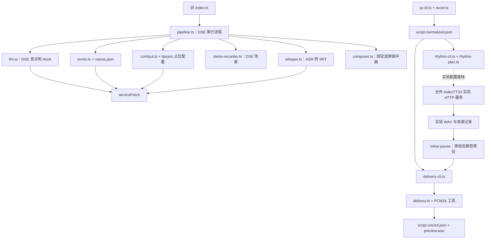

# VP-ARCH-002｜VideoPipeline 公共能力梳理与复用边界审计

审计日期：2026-10-27。代码基线：`main`，HEAD `404f8d5`，同时纳入当前未提交工作区的真实声音工具和报告。性质：只读架构审计，仅新增本报告；未执行安装、重构、服务启停或 GPU 推理。

结论：当前值得优先复用的是**模型服务部署与资源保护经验、保守 PCM 音频工具、可追溯的音频时间线**。它们尚未组成跨项目 SDK。Excel 导入已真实验证，但属于输入适配层；DSE 带货流程、模型实验执行器和旧竖屏合成模板应保留各自边界。优先评审数据契约，等第二个项目出现实际调用需求后，再抽取最小代码差额。

## 1. 公共能力成熟度矩阵

状态定义：**真实**＝存在真实输入和产物证据，但不自动代表通用、商业授权或最终人工验收；**局部**＝有实现，仅有 mock、合成素材或局部测试证据；**骨架**＝入口/占位存在，缺少关键资源；**未实现**＝当前盘点范围没有实现；**设想**＝仅在需求中出现。不同子能力分别评级。

| 能力 | 状态与实际范围 | 证据与未达成部分 |
|---|---|---|
| HTTP 基础包装 | 局部：网络错误和非 2xx 错误附服务名、地址、响应摘要 | `orchestrator/src/clients/http.ts`；没有默认请求截止时间、取消、错误码类型或统一幂等协议 |
| GPT-SoVITS 公共服务 | 真实：v2ProPlus 本人参考音频 TTS、真实 HTTP/WAV | `docs/reports/VP-002B-G2-deployment.json`、`VP-002B-G3A-validation.json`；本轮 `/health` 返回 ready。长段情绪效果未获选，不代表部署不可用 |
| 仓内 SoVITS 客户端 | 局部：配置、HTTP 调用、一次重试已实现；默认业务配置仍占位 | `src/clients/sovits.ts`、`config/voices.json`，提交 `2eaab64` 记录 mock 测试；不能用 G2 服务推理成功证明旧 DSE 客户端已接通本人音色 |
| IndexTTS2 | 真实：R4/R5/G4 推理；HTTP 外壳仍为固定实验接口 | `/home/chen/ai-services/indextts2/serve.py:48–55,109–135`；只收 `{"trial":...}`，文本/参考/输出由服务器配置锁定，当前剩余次数 0；仓内没有通用 IndexTTS2 客户端 |
| GPU 资源保护 | 真实但范围有限：两个 TTS 服务共享非阻塞文件锁，加载及请求期间保护 | 两个服务 `serve.py` 的 acquire/Guard；G4 报告记录利用率门限真实拒绝。不是跨所有项目的强制隔离、排队、抢占或显存卸载 |
| Excel 导入 | 真实：Day9 十镜、列名映射、原文保留、校验与来源哈希 | `src/import/excel.ts`、`excel.test.ts`、`ip-cli.ts`；`output/day9/script.normalized.json`。未包含 AI 分镜导演 |
| 句间节奏规划 | 真实＋单元测试：原文无损分段、完整句边界、跨镜未完句保护 | `src/voice/rhythm-plan.ts`、`rhythm-plan.test.ts`；R5/G4 实验记录。主要面向中文句末标点，不是通用语义韵律理解 |
| 句内异常停顿检查 | 真实＋单元测试：可信合成区域内检测，人工批准后缩短严格静音核心 | `src/voice/inline-pause.ts`、`inline-pause-cli.ts`、对应测试；`local-assets/voice/experiments/day9-r5-inline1/`。不自动剪除所有短停顿，不是音素识别或强制对齐 |
| PCM 拼接/音频时间线 | 真实＋单元测试：十镜、哈希校验、已有静音计入、缺口补足、交付复用 | `src/voice/delivery.ts`、`delivery-cli.ts`、`delivery.test.ts`；G4 `script.voiced.json` 和 `checks/complete-validation.json`。只支持同采样率单声道 PCM16 WAV |
| 字幕转写 | 仓内局部实现；声音实验已有真实 CPU ASR 检查 | `src/clients/whisper.ts` 输出识别分段 SRT；G4 `checks/shot-*.json`、`preview.json` 是已有 small 模型的离线检查。两者不是同一运行入口，不能互相替代接口验收 |
| 已知旁白精确字幕对齐 | 未实现 | 没有将正式旁白对齐至词/字的公共实现；ASR 时间戳不能直接作为字级正确对齐证据，整镜时间线也不是逐句字幕 |
| ComfyUI 调用 | 局部：HTTP+WS、节点 patch、超时、history/view 下载 | `src/clients/comfyui.ts`，提交 `1d3ff80` 明确为 mock HTTP/WS 验证；没有真实模型工作流成功证据 |
| Wan 适配/工作流 | 骨架：README 提到 broll，但没有实际 API JSON、Wan 配置或导演接线 | `orchestrator/workflows/README.md`、`config/workflows.json` 仅 lipsync TODO。现有模型目录不是可执行工作流，详见运行盘点 |
| 素材索引与匹配 | 未实现；语义检索/自动复用是设想 | `ImportedShot.assetMatch` 只是两个空字段；`assets/hooks.json`、`selling-points.json` 是带货文案库，不是媒体索引。PRD v2.0 F3.1/F3.2 是需求 |
| FFmpeg 合成 | 局部：旧模板确有实现，历史有假素材实际 FFmpeg 测试 | `src/compose/composer.ts`；提交 `0c23d35` 记录 25 秒/8 秒假素材、字幕路径转义测试。没有 Day9 真实画面成片；不是空壳，也不是通用时间线渲染器 |
| Remotion/文字卡/图解 | 未实现；模板能力属于规划 | 仓内源码和依赖清单未见 Remotion；PRD v2.0 F3.3 的文字卡/图解尚无模板实现 |
| 日志、错误处理 | 实现但仅局部流程验证 | `src/logger.ts`、`clients/http.ts`、`pipeline.ts`；步骤耗时和失败日志存在，但没有跨服务统一错误/取消/重试协议 |
| Job/队列/通用断点恢复 | 通用能力未实现；音频交付局部恢复真实验证 | 原 PRD `Job`、`output/jobs/<id>.json` 是规划。旧 pipeline 串行 for 循环不等于队列；G4 指纹复用和实验 attempt-state 不是通用 Job 引擎 |

测试证据等级：G4 报告及机器记录保存了 **23 项测试通过、tsc --noEmit 通过**；本轮阅读四个现有测试文件，没有重新运行测试或将历史通过冒充本轮执行。四类为 Excel 10 项、节奏 4 项、句内静音 6 项、交付 3 项。旧客户端 mock 和 FFmpeg 假素材测试主要依据 Git 提交正文，当前没有找到对应持久化测试套件，证据强度低于现存测试与真实产物。

本轮额外只读复核：十个 G4 WAV 的 SHA-256、WAV 头、采样帧数均与交付 JSON 一致（22050 Hz、单声道、16-bit）。完整解码、ASR、无异常截断等结论引用 G4 已存记录，不宣称本轮重新完成听审。G4 最终预览状态仍为 `awaiting-holder-final-preview-review`。

## 2. 现有代码依赖关系与运行证据

以下均以仓库根为相对路径基准，`src/` 在本报告表格中指 `orchestrator/src/`。



这两条流程没有在 `pipeline.ts` 汇合；个人 IP 配音已经做完，不表示新素材导演已接入，也不能为复用而重新启动 DSE 文案生成。

### 2.1 公共服务实况

2026-10-27 09:48 UTC 前后，只读直连 localhost 的结果：

| 地址/资产 | 观察 | 架构含义 |
|---|---|---|
| `127.0.0.1:9880/health` | HTTP 200，ready，GPT-SoVITS v2ProPlus，CUDA | 服务已启用；旧仓内 `voices.json` 的 TODO 和容器路径仍需独立适配 |
| `127.0.0.1:9881/health` | HTTP 200，ready，IndexTTS2，experiment=G4-SHOT10，attempts=1，remainingAttempts=0 | 模型已加载，但本轮授权实验额度用尽；ready 不等于可继续提交新文本 |
| `127.0.0.1:8188/system_stats` | connection refused | 此地址当前没有可访问服务；不能据此推断整台服务器从未安装 ComfyUI |
| `127.0.0.1:8080/health` | connection refused | 旧 Whisper HTTP 入口当前未响应；不影响已有 CPU ASR 检查证据 |
| `/home/chen/ai-models/` | 现有 GPT-SoVITS、IndexTTS2；检查的 `/home/chen/ComfyUI`、`/home/chen/ai-models/ComfyUI` 不存在 | 本轮核查位置没有 ComfyUI 程序，不声称穷尽全盘其他安装 |
| `/home/chen/comfyui-models/Wan2.2-TI2V-5B/` | 排除下载缓存后只列出 `split_files/vae/wan2.2_vae.safetensors` | 有可复用 VAE 资产；未据此确认完整 Wan 推理权重、节点或工作流。没有移动、删除或下载 |
| `orchestrator/output/`、`local-assets/` | 本轮遍历未发现 mp4/mov/webm | 这些输出目录没有现存真实成片证据；不否认 Git 记录中的历史假素材测试 |

首次 Python HTTP 检查受代理设置影响返回 502；改用 `ProxyHandler({})` 直连后获得上表结果，502 不作为服务故障结论。

服务程序/权重/配置分别位于 `/home/chen/ai-models/`、`/home/chen/ai-models-data/`、`/home/chen/ai-services/`。仓内 `docker-compose.yml` 和 `install-comfyui.sh` 是旧部署说明，包含仓内权重挂载和宽监听等旧约定，不能当作当前公共架构的启动入口。本轮未执行它们。`CLAUDE.md` 中 `PRD.md` 路径也已陈旧，实际需求文件在 `docs/`；v2.0 自标为待确认草案，能力事实以代码、产物和后续持有人裁定为准。

### 2.2 GPU 与状态机制的实际边界

- GPT-SoVITS：`/home/chen/ai-services/gpt-sovits/serve.py:35–77`；加载和整个 TTS 响应期间持有共享 flock，空闲显存至少 12288 MiB、温度低于 85°C。IndexTTS2 `serve.py:36–44` 再加利用率不高于 15% 的条件。两个实现有差别，不能写成同一门限。
- 两者锁路径均为 `/home/chen/ai-services/gpu.lock`，忙时快速拒绝，不自动排队。GPU 锁只约束遵守该协议的进程；未接锁的其他项目仍可占用 GPU，释放锁不会自动卸载驻留权重。未来 ComfyUI 接入时必须验证保护覆盖整个执行周期。
- IndexTTS2 `serve.py:100–135` 把固定 trial 的尝试写入 JSON，失败会 halted；没有重启后自动续算中断推理的机制。写 started 后进程崩溃仍可能消耗额度，不能把它包装成可靠任务恢复。
- `delivery-cli.ts:40–81` 验证输入指纹及已有试听哈希，重复调用可以复用成功交付；缺镜/原文不匹配/音频哈希错误有真实拒绝记录。它不调用 TTS，也不负责调度失败镜头。preview 和 JSON 分别写入，没有跨文件事务或通用并发提交锁。
- `pipeline.ts` 的单任务 catch 后继续，会让整批所有任务失败时仍可能正常 resolve；`index.ts` 只对顶层 reject 返回非零。不能据进程成功退出判断所有分镜完成。目录扫描递增 ID 也没有跨进程原子分配保护。

## 3. 公共与业务私有边界：候选模块逐项判断

下表的“可调用”指当前真实边界，推荐方式是未来最小动作，均未在本轮实施。

| 候选与路径 | 实际功能/依赖及业务耦合 | 独立项目当前能否调用 | 推荐方式、抽取前提与过早抽取风险 |
|---|---|---|---|
| `src/clients/http.ts` | Node fetch；无品牌规则 | 可复制调用；不是已发布包 | **复制稳定实现**即可。需要统一截止时间/错误分类时再补差额；过早造 SDK 会掩盖各服务不同重试语义 |
| `src/clients/sovits.ts` | fetch+fs，绑定 zh/yue、配置相对 CWD、固定 speed_factor=1.05、输出写盘；音色配置依赖旧容器路径 | 服务可 HTTP 调用；该客户端需配置适配 | **公共 HTTP 服务**。客户端以后注入 voice/config/路径并验证 WAV；先别抽出带货默认值为全项目标准，409 也不应无差别重试 |
| `src/clients/llm.ts` | 兼容 HTTP 协议，但与 DSE 提示词、卖点/Hook JSON、VideoScript 模型合在一起 | 无法原样当通用写作客户端 | **业务私有**；第二消费者确需相同 transport 时仅提取请求层。过早共享会传播带货话术和脆弱数组强制类型转换 |
| IndexTTS2 `ai-services/indextts2/serve.py` 与 `rhythm_adapter.py` | Python/PyTorch、模型和参考资产、固定实验配置；含 VideoPipeline 根路径/输出、私有声音与次数预算 | 只能调用已授权 trial；不能任意新项目输入 | 计算归属保持**公共 HTTP 服务**，实验策略留私有。前提是另行批准文本/voice profile/输出引用/API 错误和幂等契约；不能复制私有音色锁和实验预算成为公共默认 |
| 两个 `ai-services/*/serve.py` GPU guard | Python fcntl、nvidia-smi、Linux/WSL 路径；无文案耦合但阈值与模型耦合 | 其他服务遵守同一锁可协作；业务 TS 不需直接管理 Python 锁 | **服务侧保护协议**，暂不另建平台。先明确锁生命周期、忙返回、资源预算和非参与服务边界；过早共享调度器会误许并发安全和自动卸载 |
| `src/voice/rhythm-plan.ts` | Node crypto；运行逻辑不含品牌词；类型 Pick 仍引用 ImportedShot，中文标点规则 | 纯函数可用，CLI 输入绑 ip-script | 近期**复制稳定实现及测试**；两项目确有一致需求再共享代码包。先换最小 narration 输入类型、分离 profile；350/600/700ms 是当前产品选择，不宜当传记通用节奏 |
| `src/voice/inline-pause.ts` 与 CLI | Buffer、PCM16、合成区域来源与人工审核；无品牌特判 | 纯函数可用；需满足格式与可信区域契约 | **复制稳定实现及测试**。保持默认只检测、审核门槛和时间映射；提前自动化会误剪闭塞音/低声字音，不能拿 ASR 猜区域 |
| `src/voice/delivery.ts` | Node Buffer；调用 inline-pause WAV 工具；无业务文案 | 可直接复用函数，只接受同采样率 mono PCM16 | **最有价值的共享代码包候选**；先复制带测试，待第二消费者证明需要再抽包。前提明确 gap 语义、PCM 格式与内存上限；长视频整段 Buffer.concat 的内存开销需另测 |
| `src/voice/delivery-cli.ts` | Node fs/crypto；绑定 ImportedScript、sourceRow、固定 scope/hearingStatus、绝对路径 | 可供同格式项目运行，不能当通用时间线导出器 | CLI **业务私有**，共享其哈希/拒绝覆盖原则；前提是独立契约适配层，不强迫新项目伪造 Excel 行号 |
| `src/import/excel.ts`、`ip-cli.ts` | read-excel-file；真实中文列名/必填字段及 rawCells | 可以作为该类 Excel 的导入工具；传记/漫剧未必用此格式 | **输入适配器留仓内**，有第二份同格式需求时复制。不要把 Excel 来源字段变为公共分镜必填字段 |
| `src/clients/whisper.ts` | fetch/FormData，指定 large-v3，识别文本转 SRT；无品牌硬编码 | HTTP 服务恢复并验证响应后可用；当前该端口未响应 | **HTTP ASR 服务＋薄客户端**；先明确识别/对齐分工、语言与时间戳。不能把识别错误写回正式旁白，也不能把当前 fmt 毫秒舍入边界未经测试封为公共标准 |
| `src/clients/comfyui.ts` | ws、HTTP、API JSON、节点映射，当前 CWD 配置；逻辑不限定模型，业务调用只 lipsync | transport 可适配；配置仍 TODO，缺实际工作流 | **公共 ComfyUI HTTP 服务＋项目自有 workflow adapter**。先跑通固定版本真实工作流、指定输出节点及输入资产传输、验证 GPU 保护。直接共享会固化节点版本和“取首个视频”假设 |
| 素材索引 | 仅 `ImportedShot.assetMatch` 空字段；没有索引实现/存储依赖 | 不能 | **目前不抽取**。先在 Day9 建真实素材来源/授权/哈希/探测信息与匹配记录；不为两个未来项目先搭语义平台 |
| `src/compose/composer.ts` | fluent-ffmpeg+系统 ffmpeg/ffprobe+字体；固定 1080×1920/30fps、右下画中画、录屏、烧录 SRT | 可调用旧模板，不接受通用 Timeline | **保留业务模板私有**，复用已验证的 FFmpeg 路径处理经验。通用渲染适配需另立契约映射与真实多镜测试；不把旧模板重命名为通用渲染引擎 |
| `src/record/demo-recorder.ts`、`pipeline.ts`、assets 两 JSON | Playwright、DSE 页面/场景、Hook/CTA、metrics | 仅适用于旧业务且人工资源仍 TODO | **保留业务私有**。浏览器录屏技术可借鉴，不共享 DSE 选择器、发布指标或脚本规则 |
| `src/logger.ts`、实验/交付状态文件 | Node fs、步骤计时；日志无品牌，状态各自专用 | logger 可复制；没有可调用通用 Job 引擎 | **复制小工具和产物验证模式**。未来单项目先做文件 manifest；等确有相同恢复规则再谈包，日志文件不等于持久化状态机 |

模型接口不应传业务 Excel 行，也不应让各业务仓安装 Python/模型。业务端负责脚本、镜头与审核；服务端负责固定模型、资产校验、GPU 保护和推理；渲染适配器负责把契约转成具体工具参数。

私人本人音色不是自动可复用的“公共声音资产”。即使其他项目由同一持有人运营，也应显式选择获授权 voice profile，不能继承默认私人路径。本次 IndexTTS2 资产/输出仍受**私人非商业评估授权**限制；现存 MaskGCT 辅助权重的非商业限制尚未解决，不能从“服务可复用”推导出 YouTube 公开或商业使用许可。依据用户 R4 裁定及 `/home/chen/ai-services/indextts2/` 许可/资产留档；本报告不新增商业许可结论。

## 4. 最小 Timeline / Storyboard Contract v0.1 草案

**以下仅供评审：尚无对应类型、JSON Schema、验证器、转换器或渲染器实现。** 现有 `ip-script/1` 和 `ip-script-voiced/1` 保持不变。建议用同一文档承载“镜头意图＋已落实时间线”，用状态区分草案与可渲染交付，不再复制一份互相漂移的镜头顺序。

### 4.1 最小字段和语义

| 字段 | v0.1 约定 |
|---|---|
| `schemaVersion`, `id`, `revision` | 固定 `timeline-storyboard/0.1`；项目内稳定 ID 与不可变产物版本 |
| `status` | `draft` / `ready-for-render`；draft 允许视觉/字幕未完成，ready 必须通过下述校验 |
| `timebase.ticksPerSecond` | 正整数；所有时间字段均为整数 tick、半开区间 `[start,end)`。项目选择可准确表达音频/目标帧率的时基；不是固定毫秒、视频帧或某模型采样率 |
| `durationTicks` | 全局结尾，包含镜头间显式空隙，不从建议时长推算 |
| `output`（可选） | 实际宽高及帧率 `{num,den}`；不预设比例。ready 时交给渲染器的输出规格必须明确；规格不影响原文与资产身份 |
| `assets[]` | `id, kind(audio/image/video), uri, sha256`；时长资产另含原生 `durationTicks,ticksPerSecond`，可附 sampleRate/channels。URI 通过项目 resolver 解析，哈希是完整内容哈希，ID 不依赖绝对路径 |
| `shots[]` | `id, order, startTicks, durationTicks, narrationText, visualBrief, overlayText, audio, visual, subtitles`。id 是字符串，order 表示镜头排序，原编号/Excel 行号不是公共必填项 |
| `audio` | null 或 `{assetId, sourceInTicks, sourceOutTicks}`；source 时间使用被引用资产的原生时基，播放时映射到项目时基。v0.1 一镜一个旁白片段，原速，不隐含加速/裁字 |
| `visual` | null 或 `{assetId, sourceInTicks?, sourceOutTicks?, fit}`，fit=`contain`/`cover`。v0.1 一镜一个主视觉；静态图持续覆盖该镜，视频须覆盖该镜所需时长。不隐式循环或拉速 |
| `subtitles` | `[]` 或 `{startTicks,endTicks,text,reviewStatus}` 数组，时间均为**全局绝对项目 tick**；text 是显示文字，不能覆盖 narrationText。机器识别/待对齐不能标成人工核准 |
| `extensions`（可选） | 带命名空间的来源/审核记录，不参与时间计算；不得通过它暗藏未经定义的多轨播放语义 |

`overlayText` 是显示内容/意图，允许 null，不等于已生成文字卡；`visualBrief` 也不等于已存在媒体。模型参数、提示词、Excel 单元格及渲染代码放来源/生产记录，由引用关联，不进入播放语义。

镜头默认不重叠。上一镜 end 到下一镜 start 的区间是**显式外部间隔**：声音为静音，画面默认延续上一镜至下一镜开始；首个镜头必须从 0 开始，全局结束等于最后镜头 end。素材内部静音仍属于素材自身时长。此项默认也需评审确认，避免不同适配器自行选择黑场或重复补停顿。v0.1 没有转场、多角色对话、BGM/SFX 混音和多轨调度；将来另升版本表达角色、轨道及重叠，不改变当前 start/duration/asset 语义。

### 4.2 Day9 第一镜的草案示例

下面是**契约示意**，资产哈希/URI 用占位说明，不能当作可执行交付或伪装成已导出的 JSON：

```json
{
  "schemaVersion": "timeline-storyboard/0.1",
  "id": "day9",
  "revision": "g4-audit-draft",
  "status": "draft",
  "timebase": { "ticksPerSecond": 22050 },
  "durationTicks": 271108,
  "assets": [{
    "id": "voice-shot-001",
    "kind": "audio",
    "uri": "asset:voice-shot-001",
    "sha256": "<读取现有 voiceover.audioSha256 的完整值>",
    "ticksPerSecond": 22050,
    "durationTicks": 271108,
    "sampleRate": 22050,
    "channels": 1
  }],
  "shots": [{
    "id": "shot-001",
    "order": 1,
    "startTicks": 0,
    "durationTicks": 271108,
    "narrationText": "<完整复制现有第1镜 narration，不使用此占位文本>",
    "visualBrief": "<复制 visualDescription>",
    "overlayText": "大字：一人公司，真正的风险",
    "audio": { "assetId": "voice-shot-001", "sourceInTicks": 0, "sourceOutTicks": 271108 },
    "visual": null,
    "subtitles": [],
    "extensions": { "videoPipeline.source": { "shotNumber": 1, "sourceRow": 2 } }
  }]
}
```

示例只展示一镜；完整 Day9 的 durationTicks 应为 **1847163**，而非此单镜示例的 271108。`asset:` 是拟议的项目内引用协议，现有代码没有 resolver，评审通过前不作为既有接口。

### 4.3 未来验证器至少应检查

1. 唯一资产/镜头 ID、唯一连续 order、合法完整哈希和可解析 URI；实际内容哈希及媒体探测相符。
2. tick 为安全整数；正时基、正镜头时长；镜头顺序与 start 一致、无重叠，首尾与总时长一致。
3. 音频 source 区间在资产内；按两个时基换算后等于镜头时长，不隐式变速。音频帧与视频帧分别换算，指定量化规则，不累积逐镜四舍五入误差。
4. 字幕时间递增且在所属镜头内，不得拿建议时长当对齐时间；跨镜字幕 v0.1 应明确拆分，不猜字词边界。
5. `draft` 允许缺视觉/字幕，但明确缺项；`ready-for-render` 必须有输出规格、每镜实际视觉、完整旁白引用，以及经确认的字幕覆盖或显式“本片不出字幕”决定。当前 Day9 只能映射为 draft。
6. 从输入/配置哈希构造新版本；不覆盖已经听审的媒体。完成度、许可/审核与技术可解码是不同条件。

### 4.4 现有 Day9 精确映射

| 现有字段 | 草案字段/处理 |
|---|---|
| `shots[].order`、shotNumber | order；shotNumber 转稳定字符串 id，并保留原值到来源扩展 |
| `narration` | narrationText，逐字复制，不拼 Hook/CTA，不用 ASR 替换 |
| `visualDescription`、overlayText | visualBrief、overlayText；后者不是字幕 |
| `voiceDelivery.sampleRate` | 此交付选择项目时基 22050；native audio 时基也为 22050，全部精确整数 |
| `voiceDelivery.timeline[].startFrame/durationFrames` | startTicks/durationTicks；frame 在此是**音频采样帧**，不是视频帧 |
| `voiceover.audioPath/audioSha256` | 新建逻辑 audio asset，resolver 映射现有本地路径，SHA 原样沿用；不搬文件 |
| `voiceover.durationFrames` | audio sourceOutTicks，sourceInTicks=0，包含 WAV 原有头尾静音 |
| `gapBeforeSeconds/gapAfterSeconds` | 仅校验外部间隔，不重复存两份可变真值；从相邻 start/end 求差，不能前后各加一遍 |
| `assetMatch.assetPath=null` | visual=null，状态 draft；不拿画面说明伪造实际素材 |
| 尚无正式对齐字幕 | subtitles=[] 并记录待对齐；旁白全镜覆盖不能冒充词级字幕 |
| `source`、sourceRow、rawCells、suggestedDuration、视觉/BGM/裁切指导 | 来源扩展/项目规划记录；建议时长不参与已配音时间计算；不丢失信息、不强迫其他项目生成 Excel 来源 |

本次读取到的真实帧区间：

| 镜头 | startTicks | durationTicks | endTicks | 外部 gapBeforeTicks |
|---:|---:|---:|---:|---:|
| 1 | 0 | 271108 | 271108 | 0 |
| 2 | 271108 | 164438 | 435546 | 0 |
| 3 | 435546 | 193594 | 629140 | 0 |
| 4 | 629140 | 207715 | 836855 | 0 |
| 5 | 836855 | 78569 | 915424 | 0 |
| 6 | 915424 | 213900 | 1129324 | 0 |
| 7 | 1129324 | 193251 | 1322575 | 0 |
| 8 | 1322575 | 215059 | 1537634 | 0 |
| 9 | 1537634 | 138289 | 1675923 | 0 |
| 10 | 1681531 | 165632 | 1847163 | 5608 |

总时长 `1847163 / 22050 = 83.77156462585035` 秒。前九镜原有静音已经满足要求；第九到十镜额外加 5608 个采样帧，约 0.254331 秒，连同两侧已有静音组成约 600ms。**不得重新给每镜添加 600ms。**

## 5. 建议复用方式与最小前提

优先顺序：**已有模型继续以 HTTP 共享 → 评审数据契约 → 复用少量纯函数及测试 → 第二消费者验证后才抽包**。不新建公共仓库，不建设统一平台。

- 服务层：沿用现有程序/权重/配置目录隔离。未来最小 TTS 请求需要明确 text、voiceProfileId、可复现配置版本、幂等键；响应需要产物引用/哈希/媒体信息/耗时/模型版本；忙、输入错误、推理失败应区分。这些是接口需求，当前 IndexTTS2 trial API 尚未提供。
- 代码层：PCM 拼接、WAV 检查、节奏规划比 DSE pipeline 更适合复用。第二项目初期复制稳定实现和对应测试并记录源提交/文件哈希，避免依赖当前未发布、未提交的源码目录。确有共同修改需求后再共享包，不能把复制当成永久同步机制。
- 数据层：先只读转换到新契约，保持旧 JSON 不动；业务输入来自 Excel、Markdown 或其他来源均由各项目适配。
- 资产层：公共模型资产与项目私有媒体分开；跨仓引用使用 resolver，不依赖 VideoPipeline 目录结构。localhost 只在同一网络命名空间成立，容器/远程调用须另行明确受限访问和可见路径，不能直接改为公网监听。
- 资源层：共享 GPU 锁保持服务侧，新增模型接入须先验证其遵守锁和显存预算。不要求业务仓建设调度中心，也不让服务重试绕过实验次数限制。

## 6. 当前不应该抽取的模块

1. **DSE 文案、录屏场景、旧 pipeline 与 metrics**：用途、字段、页面资源不同；从中抽“通用生产引擎”会传播业务假设。
2. **IndexTTS2 实验执行器整体**：它含固定 trial、私有路径、额度和听审策略；只应复用服务承载方式与保护原则，不能删掉授权保护后直接供新项目使用。
3. **素材平台/语义搜索/Wan SDK**：尚无真实 Day9 媒体匹配和 Wan 成功样本，不存在可抽取的稳定实现。
4. **通用 Remotion/FFmpeg 引擎**：目前没有 Remotion，实现仅旧 DSE 模板；先让具体 Day9 视觉与字幕链路成功。
5. **通用 Job/恢复/多角色调度框架**：现有恢复是声音产物级，不是跨阶段工作流；长视频/漫剧的失败边界和角色规则尚未验证。
6. **整个 Excel 数据模型**：保留导入和来源追踪，公共契约不要求 sourceRow/rawCells；不要为了统一接口重写已验收导入。

## 7. Day9 完成前需要注意的接口问题

- **听审门未自动关闭**：R5 76.01 秒版已获确认；G4 十镜预览 83.77 秒及第十镜衔接仍待最终听审，不能从技术检查推断持有人已通过。
- **公开用途尚受限**：IndexTTS2 当前路线是私人非商业评估；Day9 可生成内部初稿，但“可公开发布”另需解决适用许可和授权边界。
- **以 voiced 为时间权威**：标准化 JSON 保留原文，配音 JSON 提供实际时间；建议总时长约 32 秒不能覆盖真实 83.77 秒，也不能为对齐画面加速配音。
- **字幕仍有必要差额**：需将正式旁白对齐真实声音，再导出 SRT；ASR 用于异常核查，品牌名和同音字差异不自动触发改文案。overlayText 与 subtitle 是两套显示内容。
- **视觉不能重用旧 composer 接口冒充完成**：其 screencast/talkingHead 固定模板不适合十镜混合画面；后续应新增必要适配，保留旧 DSE 入口。`-shortest` 会受最短输入影响，必须验证视觉覆盖完整配音，不能静默截尾。20–60 秒警告也不适用于当前 Day9。
- **ComfyUI 仍需真实接线**：输入路径是服务端可见路径，不等于上传；需固定 API workflow、节点版本、生成种子、明确输出节点及模型资产，先查现有 VAE 及其他目录再决定任何下载。当前 runWorkflow 取 history 中首个匹配视频，尚无 Wan 选择/验证策略。
- **跨镜静音与视频画面覆盖**：保留采样级时长和外部 gap，画面在 gap 的延续规则须明确。转为 30fps 时只在渲染边界量化；不能逐镜取整后累积漂移。
- **局部重做的失效范围**：某镜音频变化会影响该镜及后续 start、字幕和视觉长度；不能仅换 WAV 路径保留旧时间线。产物记录应引用脚本、音色配置、音频和视觉哈希，并生成新版本。
- **当前 Git 状态未形成发布包**：语音目录和报告尚有未跟踪文件，Day9 output/声音文件按约定忽略。这是当前工作区事实，未来复用须固定可追溯源码版本，不能推送私有音频或模型。

## 8. 未来 Biography Studio 启动时的最短复用路径

1. 在独立项目建立自己的脚本/章节输入，只采用本报告评审通过后的最小契约；第一目标是一小段真实章节，不先复制整个短视频仓库。
2. 复用 AI Server 的既有模型安装及权重，不重复部署。先确认拟公开/商业用途许可和声音授权；当前 IndexTTS2 评估授权不能自动延伸至 YouTube 成片。
3. 在另行授权下为所需 TTS 补齐小型、项目无关 HTTP 接口和受控资产引用，继续共享 GPU 保护；不绕过当前固定实验额度，不改动 GPT-SoVITS 既有行为。
4. 从已验证的 PCM 拼接/哈希/时间线实现及测试开始，适配新输入。传记长篇的章节断点、英文/多语言标点、长音频内存和字幕对齐另用真实章节验证，不把 83.77 秒结果外推为小时级稳定性。
5. 为该章节选择已获授权的真实媒体，完成一个渲染适配器的单章闭环；不依赖尚未实现的 Wan 或素材语义平台。根据第二个消费者实际重复的部分决定是否抽共享代码包。
6. AI Drama Studio 后续可复用同一模型 HTTP 层、资产身份与时间约定；多角色、并行对白、镜头连续性和多轨混音另立版本，不能声称 v0.1 或当前 DSE 流程已支持。

最小启动前提是：评审契约、明确公开使用许可、明确声音授权、提供第二项目的一段真实脚本和媒体来源；当前没有需要为此修改 Day9 或移动现有模型的理由。

## 附：本轮审计证据与边界

阅读了 README、CLAUDE.md、原 PRD 数据模型/Phase 需求、PRD v2.0、现存四份任务报告、全部客户端与关键 pipeline/录屏/合成/导入/语音工具、四个测试文件及相关 Git 提交正文；读取仓外两个 TTS 服务的实际保护与 HTTP 入口代码。执行的是 `rg`/源码读取、`git log/status/show`、Python `-B` JSON/WAV 头和哈希读取、关闭代理后的 HTTP GET 健康检查与既有目录/产物遍历。未 POST TTS、未运行 GPU 推理、未重新跑测试、未下载或启停服务。

受保护输入复核值：

- `orchestrator/output/day9/script.normalized.json` SHA-256：`4b9e3a438cc80b205b332a4d37aac00d9de5c2a67cdb492fce213942e5c2fa38`。
- `orchestrator/output/day9/script.voiced.json` SHA-256：`fa1a3020df17c32a657af10fcaee97c6c18c7c219ae9853a4a1b65e43da3af6c`。

审计没有技术阻断；未达成的通用接口、视觉/字幕/成片能力和 G4 人工听审均已明确标注。报告与契约草案等待持有人评审，本轮不继续实施。
